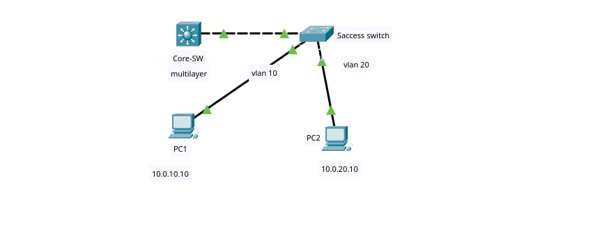
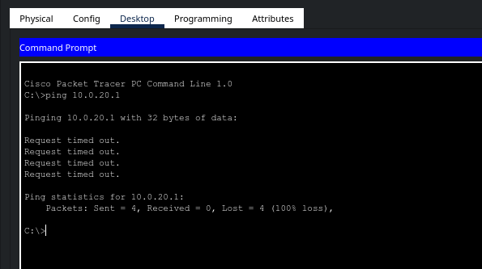
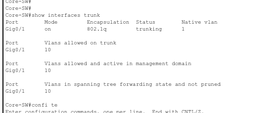
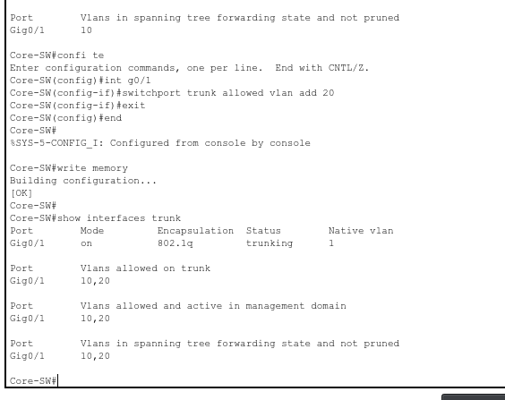
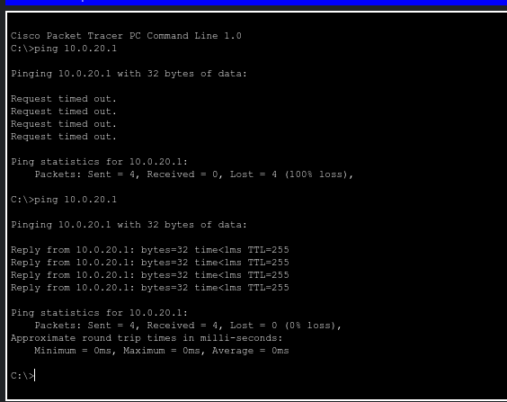

# Scenario 001: Inter-VLAN routing failure from trunk allowed-VLAN misconfiguration

**Date:** 2025-11-XX
**Platform:** Cisco Packet Tracer
**Technologies:** VLAN, 802.1Q trunking, SVI, inter-VLAN routing
**Difficulty:** Easy

## Topology

- **Core-SW** (WS-C3560) — L3 gateway, `ip routing` enabled, SVIs for VLAN 10 & 20
- **Access-SW** (WS-C2960-24TT-L) — access layer, Fa0/1 → VLAN 10, Fa0/2 → VLAN 20
- **PC1** — 10.0.10.10/24, GW 10.0.10.1, VLAN 10
- **PC2** — 10.0.20.10/24, GW 10.0.20.1, VLAN 20

## Symptom
PC2 cannot ping its default gateway `10.0.20.1` and cannot reach PC1.
PC1 can ping its gateway `10.0.10.1` successfully.
Same-VLAN connectivity is fine — only VLAN 20 traffic fails.

## Initial hypothesis
Either the VLAN 20 SVI is down on Core-SW, or the trunk between Core-SW and Access-SW is not carrying VLAN 20.

## Diagnostic steps

### 1. Verify SVI status on Core-SW

    Core-SW# show ip interface brief
    Interface   IP-Address    OK? Method Status Protocol
    Vlan10      10.0.10.1     YES manual up     up
    Vlan20      10.0.20.1     YES manual up     up

Both SVIs are **up** — Layer 3 config is correct. The fault must be Layer 2.

### 2. Check trunk on Core-SW

    Core-SW# show interfaces trunk
    Port    Mode  Encapsulation  Status    Native vlan
    Gig0/1  on    802.1q         trunking  1

    Port    Vlans allowed on trunk
    Gig0/1  10

VLAN 20 is **missing** from the allowed list. That's the fault.

### 3. Cross-check on Access-SW

    Access-SW# show interfaces trunk
    Port    Mode  Encapsulation  Status    Native vlan
    Gig0/1  on    802.1q         trunking  1

    Port    Vlans allowed on trunk
    Gig0/1  10,20

Access-SW allows both. The trunk is asymmetric — Core-SW's allowed list is the restriction.

## Root cause
`switchport trunk allowed vlan 10` on Core-SW Gig0/1 excludes VLAN 20.
Frames from VLAN 20 reach Access-SW, get 802.1Q-tagged, cross the trunk, and are dropped by Core-SW because VLAN 20 is not in the allowed list.

**Why SVIs still looked healthy:** an SVI stays `up/up` as long as *any* port in that VLAN is up. The SVI being up is not proof that the trunk carries the VLAN.

## Fix

    Core-SW(config)# interface GigabitEthernet0/1
    Core-SW(config-if)# switchport trunk allowed vlan add 20

`add` appends VLAN 20 to the existing list. Using `switchport trunk allowed vlan 20` (without `add`) would have **replaced** the list and knocked VLAN 10 offline.

## Verification

    Core-SW# show interfaces trunk
    Port    Vlans allowed on trunk
    Gig0/1  10,20

Connectivity after the fix:

- PC2 → 10.0.20.1  ✅
- PC2 → 10.0.10.10 ✅
- PC1 → 10.0.20.10 ✅

## Boot-time warning encountered
On Access-SW power-on, before the trunk was configured:

    %SPANTREE-2-RECV_PVID_ERR: Received 802.1Q BPDU on non trunk GigabitEthernet0/1 VLAN1.
    %SPANTREE-2-BLOCK_PVID_LOCAL: Blocking GigabitEthernet0/1 on VLAN0001. Inconsistent port type.

Cause: Core-SW was already trunking while Access-SW was still on default access config. STP blocked the port to prevent a loop, then recovered once `switchport mode trunk` was applied. Harmless in the lab, but in production the safer order is to configure both ends of a trunk in the same change window.

## Lessons learned
- `show interfaces trunk` must be checked on **both ends**. One side showing `10,20` says nothing about the other.
- An SVI in `up/up` state does not prove the trunk carries its VLAN — the SVI only needs one active port in the VLAN.
- Use `switchport trunk allowed vlan add <id>` on live trunks; redefining with `switchport trunk allowed vlan <ids>` will silently drop VLANs not listed.
- Default trunk behavior permits all VLANs — the allowed list here was a deliberate restriction, a realistic result of a botched change window.
