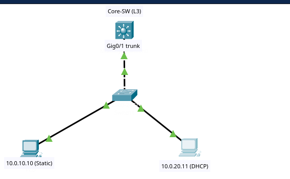
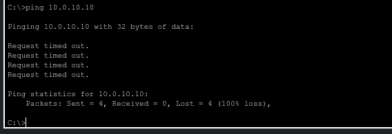
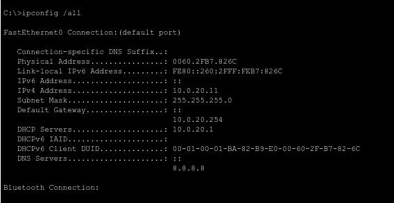
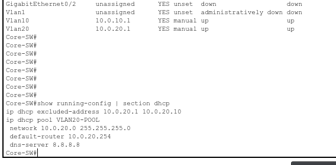
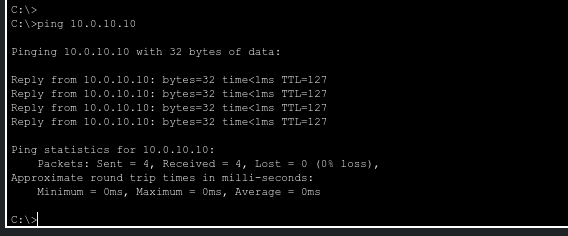
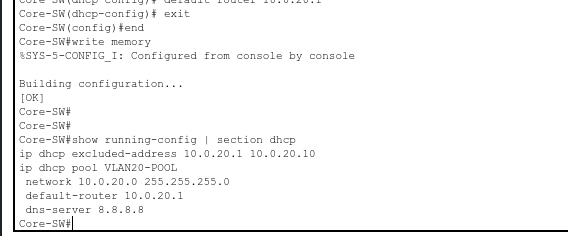
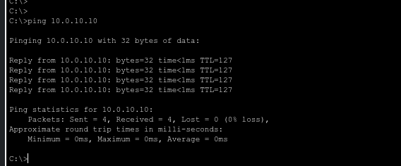

# Scenario 002: DHCP client gets IP but cannot route off-subnet

**Date:** 2025-11-13
**Platform:** Cisco Packet Tracer
**Technologies:** DHCP, inter-VLAN routing, SVI
**Difficulty:** Medium

## Topology

- **Core-SW** (WS-C3560) — L3 gateway and DHCP server for VLAN 20
- **Access-SW** (WS-C2960-24TT-L) — access layer
- **PC1** — 10.0.10.10/24, Static IP, GW 10.0.10.1 (VLAN 10)
- **PC2** — DHCP client on VLAN 20

## Symptom
PC2 receives an IP address from the DHCP server successfully, but cannot ping PC1 (10.0.10.10) or any off-subnet destination. However, PC2 *can* ping its actual gateway IP (10.0.20.1) and other devices in its own subnet.

## Initial hypothesis
Since PC2 successfully obtained an IP, Layer 2 connectivity and the DHCP service are working. The inability to route off-subnet suggests either a routing issue on Core-SW or an incorrect default gateway pushed by DHCP.

## Diagnostic steps

### 1. Check PC2's IP configuration

    C:\> ipconfig /all
    Physical Address................: 000C.85XX.XXXX
    IP Address......................: 10.0.20.11
    Subnet Mask.....................: 255.255.255.0
    Default Gateway.................: 10.0.20.254
    DHCP Server.....................: 10.0.20.1
    DNS Server......................: 8.8.8.8

**Key finding:** PC2 has an IP and a DHCP server address, but its default gateway is `10.0.20.254`.

### 2. Verify the actual gateway on Core-SW

    Core-SW# show ip interface brief
    Interface   IP-Address    OK? Method Status Protocol
    Vlan10      10.0.10.1     YES manual up     up
    Vlan20      10.0.20.1     YES manual up     up

The real gateway for VLAN 20 is `10.0.20.1`. The DHCP client is pointing to a non-existent address (`.254`).

### 3. Check the DHCP pool configuration

    Core-SW# show running-config | section dhcp
    ip dhcp excluded-address 10.0.20.1 10.0.20.10
    !
    ip dhcp pool VLAN20-POOL
     network 10.0.20.0 255.255.255.0
     default-router 10.0.20.254
     dns-server 8.8.8.8

**Root cause found:** The DHCP pool is configured with `default-router 10.0.20.254` instead of the correct `10.0.20.1`.

## Root cause
A typo in the DHCP pool configuration (`default-router 10.0.20.254` instead of `10.0.20.1`) caused PC2 to receive an invalid gateway. When PC2 tried to send traffic to a different subnet, it sent the frame to the non-existent `.254` MAC address, causing the packets to be dropped.

## Fix

    Core-SW(config)# ip dhcp pool VLAN20-POOL
    Core-SW(dhcp-config)# default-router 10.0.20.1
    Core-SW(dhcp-config)# exit

Then, on PC2, force a DHCP lease renewal to get the new gateway:

    C:\> ipconfig /release
    C:\> ipconfig /renew

## Verification

    C:\> ipconfig /all
    Default Gateway.................: 10.0.20.1

    Core-SW# show running-config | section dhcp
     default-router 10.0.20.1

Connectivity after the fix:

- PC2 → 10.0.10.10 ✅

## Lessons learned
- "I have an IP" doesn't mean "my network works." Always check the gateway if off-subnet routing fails.
- DHCP clients must typically `ipconfig /release` and `/renew` to pick up configuration changes on the server.
- Ping successes/failures tell a story: if you can ping your own subnet but not others, the problem is the gateway, not the wire.
