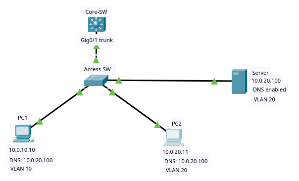
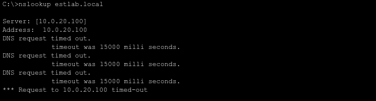
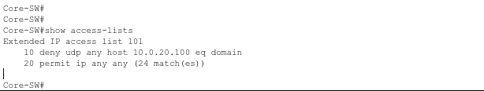

# Scenario 003: DNS Resolution Failure due to ACL

**Date:** 2025-11-15
**Platform:** Cisco Packet Tracer
**Technologies:** DNS, ACLs, inter-VLAN routing
**Difficulty:** Medium

## Topology

- **Core-SW** (WS-C3560) — L3 gateway, routing, and ACL enforcement
- **Access-SW** (WS-C2960-24TT-L) — access layer
- **PC1** — 10.0.10.10/24, Static IP, DNS: 10.0.20.100 (VLAN 10)
- **PC2** — 10.0.20.11/24, Static IP, DNS: 10.0.20.100 (VLAN 20)
- **Server** — 10.0.20.100/24, acting as DNS Server (VLAN 20)

## Symptom
PC2 cannot resolve or ping the hostname `estlab.local`, but it can successfully ping IP addresses (e.g., 10.0.10.10). PC1 can resolve `estlab.local` successfully.

## Initial hypothesis
Since PC2 can ping by IP, Layer 3 routing is working. The issue is isolated to DNS name resolution. The problem could be a misconfigured DNS server, or traffic being blocked between PC2 and the server.

## Diagnostic steps

### 1. Test `nslookup` on PC2

    C:\> nslookup estlab.local

The request times out, indicating PC2 is sending the DNS query but receiving no response.

### 2. Verify PC1 (Control Group)

    C:\> ping estlab.local

PC1 successfully resolves the name. This proves the DNS Server at `10.0.20.100` is online and functioning. The issue is specific to VLAN 20.

### 3. Check for ACLs on Core-SW

    Core-SW# show access-lists
    Extended IP access list 101
        10 deny udp any host 10.0.20.100 eq domain
        20 permit ip any any (24 match(es))

**Root cause found:** An Access Control List (ACL) is actively dropping UDP port 53 (domain/DNS) traffic destined for the DNS server.

## Root cause
An ACL (101) was applied to the interface, denying UDP port 53 to the DNS server. Because DNS queries were dropped, PC2 could not resolve hostnames, while direct IP routing remained unaffected.

## Fix
Remove the ACL from the interface:

    Core-SW(config)# interface GigabitEthernet0/1
    Core-SW(config-if)# no ip access-group 101 in
    Core-SW(config-if)# exit

## Verification

    C:\> ping estlab.local
    Pinging 10.0.10.10 with 32 bytes of data:
    Reply from 10.0.10.10: bytes=32 time<1ms TTL=127
    Reply from 10.0.10.10: bytes=32 time<1ms TTL=127
    Reply from 10.0.10.10: bytes=32 time<1ms TTL=127
    Reply from 10.0.10.10: bytes=32 time<1ms TTL=127

    C:\> nslookup estlab.local
    Server:  [10.0.20.100]
    Address:  10.0.20.100
    Name:    estlab.local
    Address:  10.0.10.10

## Lessons learned
- If you can ping an IP but not a hostname, DNS is the first thing to check.
- `nslookup` is invaluable for bypassing the local DNS cache and testing direct server communication.
- ACLs applied in the `in` direction on a router interface inspect traffic as it enters the router, which can silently drop critical services like DNS.
- Always check `show access-lists` and `show ip interface` when traffic mysteriously disappears.
